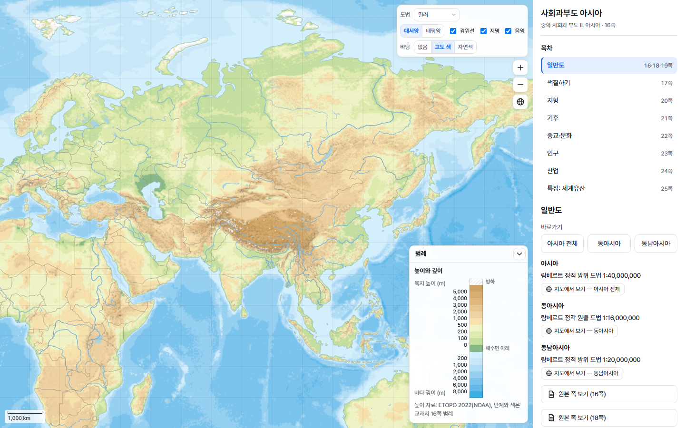
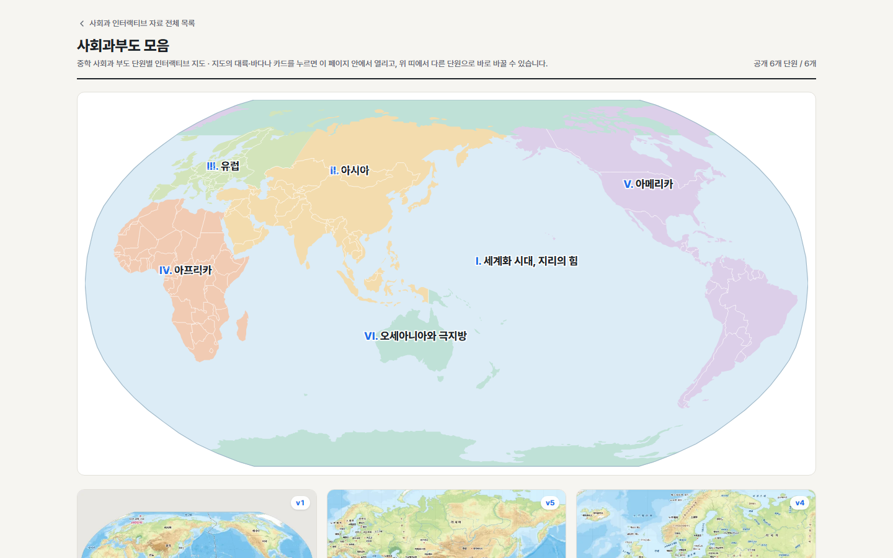

# 사회과 인터랙티브 자료 (donga-social-sims)

동아출판 2022 개정 사회과 교과서의 쪽마다 붙는 인터랙티브 자료입니다. 교과서 그림이나 지도를 학생이 직접 움직여 보는 3D 모형, 지도, 그래프로 다시 만들었습니다. 모든 자료는 다른 웹 페이지(교과서 플랫폼)에 그대로 붙여 넣을 수 있는 HTML 조각으로도 나옵니다.

- 전체 목록: https://yhk1m.github.io/donga-social-sims/
- 사회과부도 모음: https://yhk1m.github.io/donga-social-sims/atlas/



## 주소 규칙

| 주소 | 뜻 |
|---|---|
| `/<자료이름>/` | 그 자료의 최신 버전 (예: `/s1-u1-sunlight/`) |
| `/<자료이름>/<번호>/` | 버전 고정 주소 (예: `/s1-u1-sunlight/1/`). 한 번 공개한 버전은 바뀌지 않으므로 교과서나 수업 자료에 넣은 링크가 그대로 유지됩니다 |
| `/<자료이름>/<번호>/fragment.html` | 그 버전의 붙여 넣기용 HTML 조각 |

## 공개한 자료

자료마다 왼쪽은 무대(3D, 지도, 그래프), 오른쪽은 제목과 출처, 조작 칸으로 된 같은 틀을 씁니다. 쪽은 교과서 인쇄 쪽입니다. 버전 기록은 전체 목록 페이지와 `docs/versions.json`에 있습니다.

### 중학 사회 ①

| 쪽 | 자료 | 주소 |
|---|---|---|
| 9쪽 | 위도별 태양 에너지: 레이저 비유 (3D) | [s1-u1-sunlight](https://yhk1m.github.io/donga-social-sims/s1-u1-sunlight/) |
| 13쪽 | 줄어드는 지도: 교통수단과 시간 거리 | [s1-u1-time-map](https://yhk1m.github.io/donga-social-sims/s1-u1-time-map/) |
| 14쪽 | 공급망 끊기: 부품 하나가 멈추면 | [s1-u1-supply-chain](https://yhk1m.github.io/donga-social-sims/s1-u1-supply-chain/) |
| 36쪽 | 인구 피라미드 비교 | [s1-u2-pyramid](https://yhk1m.github.io/donga-social-sims/s1-u2-pyramid/) |
| 94쪽 | 초국적 기업의 발달 과정 | [s1-u5-tnc](https://yhk1m.github.io/donga-social-sims/s1-u5-tnc/) |
| 108쪽 | 태평양 거대 쓰레기 지대의 형성 | [s1-u6-garbage-patch](https://yhk1m.github.io/donga-social-sims/s1-u6-garbage-patch/) |
| 113쪽 | 북동 항로와 기존 항로 비교 | [s1-u6-northeast-route](https://yhk1m.github.io/donga-social-sims/s1-u6-northeast-route/) |
| 115쪽 | 북극 영유권 주장 | [s1-u6-arctic-claims](https://yhk1m.github.io/donga-social-sims/s1-u6-arctic-claims/) |

### 고등 통합사회 1

| 쪽 | 자료 | 주소 |
|---|---|---|
| 13쪽 | 우리 집 창은 어느 쪽? 남반구의 햇빛 (3D) | [t1-u1-sun-window](https://yhk1m.github.io/donga-social-sims/t1-u1-sun-window/) |
| 124쪽 | 하천 직강화와 범람 (3D) | [t1-u5-channelization](https://yhk1m.github.io/donga-social-sims/t1-u5-channelization/) |
| 124쪽 | 대도시권 형성 과정 (3D) | [t1-u5-metro](https://yhk1m.github.io/donga-social-sims/t1-u5-metro/) |
| 128쪽 | 스모그 뚜껑: 기온 역전과 런던 스모그 | [t1-u5-smog](https://yhk1m.github.io/donga-social-sims/t1-u5-smog/) |
| 138쪽 | 선박 평형수와 외래 생물종 (3D) | [t1-u5-ballast](https://yhk1m.github.io/donga-social-sims/t1-u5-ballast/) |
| Ⅴ단원 | 시간대별 도로 통행 속도 | [t1-u5-traffic](https://yhk1m.github.io/donga-social-sims/t1-u5-traffic/) |
| Ⅴ단원 | 지방 소멸 위험 카토그램 | [t1-u5-extinction](https://yhk1m.github.io/donga-social-sims/t1-u5-extinction/) |

### 중학 사회과 부도

사회과부도 단원 하나를 웹 지도 하나로 만들었습니다. 단원 안의 주제(일반도, 색칠하기, 지형, 기후, 종교, 인구, 산업 등)를 목차에서 고르고, 도법(밀러, 메르카토르, 로빈슨, 구드, 이퀄 어스, 극 중심, 지구본 등)과 바탕(없음, 고도 색, 자연색)을 바꿔 볼 수 있습니다. 범례를 누르면 그 항목만 강조되고, 원본 쪽 그림을 열어 비교할 수 있습니다.

| 쪽 | 단원 | 주소 |
|---|---|---|
| 8쪽부터 | Ⅰ. 세계화 시대, 지리의 힘 | [atlas-u1-world](https://yhk1m.github.io/donga-social-sims/atlas-u1-world/) |
| 16쪽부터 | Ⅱ. 아시아 | [atlas-u2-asia](https://yhk1m.github.io/donga-social-sims/atlas-u2-asia/) |
| 26쪽부터 | Ⅲ. 유럽 | [atlas-u3-europe](https://yhk1m.github.io/donga-social-sims/atlas-u3-europe/) |
| 34쪽부터 | Ⅳ. 아프리카 | [atlas-u4-africa](https://yhk1m.github.io/donga-social-sims/atlas-u4-africa/) |
| 40쪽부터 | Ⅴ. 아메리카 | [atlas-u5-americas](https://yhk1m.github.io/donga-social-sims/atlas-u5-americas/) |
| 48쪽부터 | Ⅵ. 오세아니아와 극지방 | [atlas-u6-oceania-polar](https://yhk1m.github.io/donga-social-sims/atlas-u6-oceania-polar/) |
| | 모음 (단원 카드와 세계 지도) | [atlas-hub](https://yhk1m.github.io/donga-social-sims/atlas-hub/) |



모음 보기 페이지 `/atlas/`는 세계 지도에서 대륙이나 바다를 누르거나 아래 카드를 누르면 그 단원을 페이지 안에서 엽니다(주소 `#<자료이름>`). 붙여 넣기용 조각은 `atlas-hub`입니다.

## 붙여 넣기 조각 규칙

모든 조각은 [EMBED_RULES.md](EMBED_RULES.md)를 지킵니다. 조각을 받는 쪽 페이지를 깨뜨리거나 보안 문제를 만들지 않기 위한 규칙입니다. 줄이면 다음과 같습니다.

- **래퍼 하나**: 모든 내용을 고유한 클래스의 `<div>` 하나에 담고, CSS도 그 클래스 안에서만 씁니다. 태그 선택자, `*`, `:root`, `!important`, `position: fixed`, 100이 넘는 `z-index`는 쓰지 않습니다.
- **네트워크 금지**: `fetch`, `import()`, Worker 같은 것을 쓰지 않습니다. 자료 데이터는 조각 안에 함께 들어갑니다. 외부 CDN도 피하고 글꼴은 시스템 글꼴을 씁니다.
- **안전한 DOM**: `innerHTML`, `eval`, `data:`와 `blob:` 주소 등을 쓰지 않고 요소를 하나씩 만듭니다.
- **저장소**: 개인 정보는 저장하지 않습니다. 화면 상태처럼 개인 정보가 아닌 값만 저장하고, 저장하는 줄마다 이유를 주석으로 답니다.

사진과 지형 그림처럼 조각에 넣기 어려운 큰 그림은 같은 GitHub Pages의 `docs/assets/`에 파일로 올리고 ``로 연결합니다(교사 승인).

`npm run embed`가 조각을 만든 뒤 `scripts/check-embed.mjs`가 이 규칙을 자동으로 검사합니다.

## 실행하기

```
npm install
npm run dev                                   # 개발 미리보기 (sims/<id>/)
npm test                                      # Python(사회과부도 추출) 테스트와 Node 테스트
npm run embed -- <id>                         # 조각 빌드와 규칙 검사 → embed/<id>.html, embed/preview/<id>.html
npm run release -- <id> --note "바뀐 점"      # 새 버전을 docs/<id>/<n>/ 에 고정
```

공개는 `release`가 만든 `docs/`를 커밋하고 `main`에 push 하면 됩니다. GitHub Pages가 `main` 브랜치의 `docs/` 폴더를 그대로 보여 주고, 반영까지 1, 2분 걸립니다.

### 버전 고정 방식 (`npm run release`)

1. 지정한 자료의 조각을 새로 빌드합니다.
2. 조각 내용이 최신 버전과 똑같으면 번호를 올리지 않고 끝냅니다.
3. 다르면 `docs/<id>/<n>/index.html`(그 버전 페이지)과 `fragment.html`(조각)을 새 번호로 만듭니다. 이미 있는 번호 폴더는 절대 다시 쓰지 않습니다.
4. `docs/<id>/index.html`을 최신 버전 내용으로 바꾸고, `docs/versions.json`에 날짜와 바뀐 점을 적고, 전체 목록 `docs/index.html`과 모음 `docs/atlas/index.html`을 다시 만듭니다.

`--index`는 목록 페이지만 다시 만듭니다. `--all`은 공통 파일이 조금만 바뀌어도 모든 자료의 번호를 올리므로, **실제로 고친 자료만 id를 적어 공개합니다.** 사회과부도 단원을 새로 공개하면 `npm run release -- atlas-hub`로 모음 조각도 한 번 더 공개하고, 카드 썸네일은 `node scripts/atlas/hub_thumbs.mjs <id>`로 만듭니다.

### 새 자료 만들기

`src/registry.js`에 한 줄을 더하고 `sims/_template/`를 `sims/<id>/`로 복사합니다. 각 자료는 `export default mount(root)` 하나를 내보내고, CSS는 `.ds-sim`으로 쓰면 빌드가 `.ds-<id>`로 바꿉니다. 공통 틀은 `src/shared/shell.js`, 요소 만들기와 아이콘은 `src/shared/dom.js`에 있습니다.

## 파일 구성

```
donga-social-sims/
├── sims/                 자료마다 폴더 하나 (index.html, main.js, style.css, 데이터)
│   ├── _template/        새 자료 뼈대
│   └── atlas-*/          사회과부도 단원과 모음
├── src/
│   ├── registry.js       자료 목록 (책, 단원, 쪽, 제목)
│   ├── shared/           공통 틀(shell), DOM 도우미, 테마, 동아 디자인(색, 칠판 모드, 로고)
│   └── atlas/            사회과부도 지도 엔진 (도법, 바탕, 범례, 지구본, 색칠하기)
├── scripts/
│   ├── build-embed.mjs   조각 빌드
│   ├── check-embed.mjs   조각 규칙 검사
│   ├── release.mjs       버전 고정 공개
│   ├── run-tests.mjs     npm test
│   ├── atlas/            사회과부도 PDF 추출, 바탕 그림, 대조표, 썸네일 (Python, Node)
│   └── <자료이름>/        자료별 데이터 굽기 스크립트
├── content/atlas/        사회과부도 단원별 주제 정리와 오류 기록
├── tests/                Node 테스트
├── notes/                설계 문서(specs)와 실행 계획(plans)
├── docs/                 GitHub Pages 공개 폴더 (release가 만듦, 손으로 고치지 않음)
├── EMBED_RULES.md        붙여 넣기 조각 규칙 원문
└── vite.config.js
```

교과서 PDF와 중간 산출물은 저장소에 넣지 않습니다.

## 자료 출처

교과서와 사회과부도의 내용은 동아출판의 저작물입니다. 각 자료 화면의 오른쪽 칸 맨 위에 교과서와 쪽을 적고, 자료별 출처도 화면 안에 밝혔습니다. 주요 공개 자료는 다음과 같습니다.

- 세계 지도: Natural Earth (public domain)
- 사회과부도 바탕: 고도 색은 ETOPO 2022 (NOAA), 자연색은 Natural Earth II
- 소멸위험지수: 행정안전부 주민등록 인구통계(2026년 9월 말), 경계 vuski/admdongkor(통계청 SGIS, CC BY 4.0)
- 도로 통행 속도: 서울시 교통정보센터(TOPIS) 서울시 차량통행속도(2026년 9월), 국토교통부 표준노드링크, OpenStreetMap(ODbL)
- 인구 피라미드: 유엔 세계 인구 전망(UN WPP 2024, 중위 추계), 국가통계포털(KOSIS) 주민등록연앙인구
- 사진과 일부 지도 그림: 위키미디어 공용 등, 그림마다 출처 표기

## 만든 사람

양정고등학교 지리교사 김용현  
문의: bgnlkim@gmail.com
